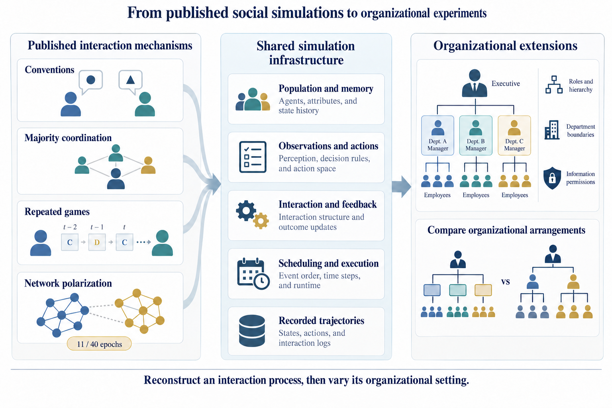
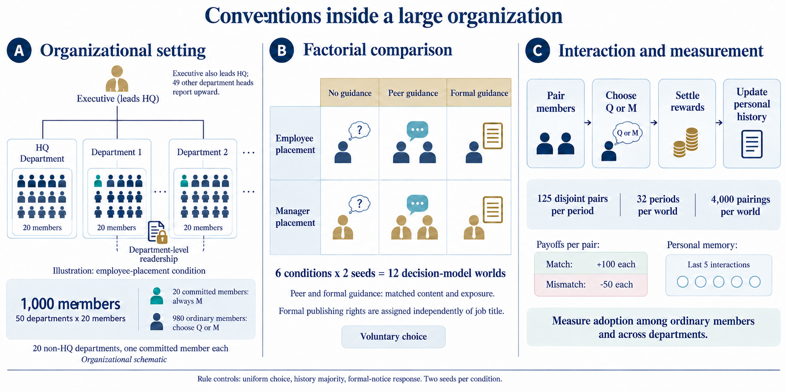
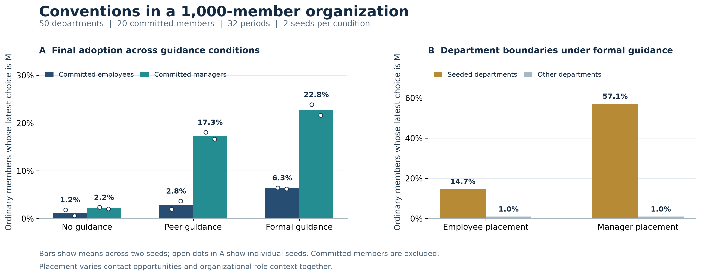

# ORDO figures

The figure assets illustrate ORDO's organizational modeling, interchangeable decision engines, execution and evidence workflow. English labels are used throughout. Diagram source files and rendered versions are retained together where available. Empirical charts are generated from recorded data, while architecture illustrations explain the system design.

Paper architecture overview: [figure](ordo_architecture_paper.png), [generation prompts](ordo_architecture_paper_prompt.txt), and [provenance](ordo_architecture_paper_provenance.json). The figure appears in Appendix A1.

## Sources and records

- [PNG](ordo_replication_extension_clean.png)
- [Replication and extension figure prompt](ordo_replication_extension_prompt.txt)
- [Revised replication and extension figure prompt](ordo_replication_extension_clean_prompt.txt)
- [PNG](ordo_organization_design_clean.png)
- [Organizational design figure prompt](ordo_organization_design_prompt.txt)
- [Organizational design figure prompt, version 2](ordo_organization_design_v2_prompt.txt)
- [Revised organizational design figure prompt](ordo_organization_design_clean_prompt.txt)
- [PNG](ordo_organization_results_clean.png)
- [PDF](ordo_organization_results_clean.pdf)
- [Organizational results figure (SVG)](ordo_organization_results_clean.svg)
- [Organizational figure data (CSV)](ordo_organization_results_clean_data.csv)
- [Organizational figure provenance (JSON)](ordo_organization_results_clean_provenance.json)
- [Organizational result plotting script](../../tools/plot_ordo_appendix_results.py)
- [Results by experimental world (CSV)](../organizational_conventions/results/world_summary.csv)
- [Detailed results (JSON)](../organizational_conventions/results/results.json)
- [Framework diagram (PNG)](ordo_framework_language_clean.png)
- [Framework diagram prompt](ordo_framework_language_clean_prompt.txt)

## Figures

