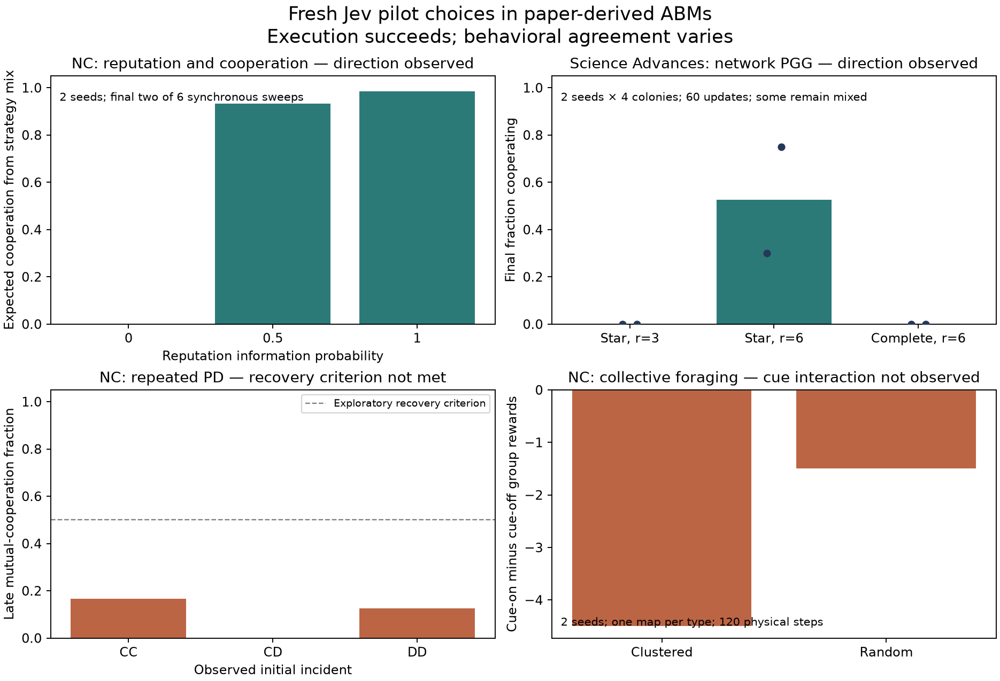

# Nine-study Jev adaptation pilot

This historical pilot connects Jev to interactive environments derived from three Science Advances, three Nature Communications and three Nature Computational Science studies. It completes 50 case configurations, 4,986 fresh judgments and 375 successful native requests. Returned model identifiers are typesafe/jev-1.14-20261014; successful-response cost totals $0.074636814. Some sources originally use conventional policies, and some pilots reduce horizons or menus.

The SA group has 16 worlds and 1,676 choices, NC 20 worlds and 1,471 choices, and NCS 14 worlds and 1,839 choices. Cooperation and transfer effects vary by source and condition. Source-specific analyses preserve supportive and unsupported outcomes. Conditions use two environment seeds; judgments are event questions, not independent people or worlds.

Requests contain each member's local information. Recovery restores a response only for the same original event and identical input. All 50 cases match exact offline replay of saved inputs, probabilities, actions and metrics. The recorded regression suite passed 164 checks. Provider billing for nine unsuccessful attempts is unknown; client reserve estimates total approximately $0.001153.

NC execution takes 61.97 cumulative seconds, NCS 202.56 and SA 318.79, including analysis and recovery; overlapping groups are not summed as wall time. NCS recovery normalizes tuple metadata to JSON arrays without changing its frozen source, inputs, choices or sampling. Use the recorded plans, group analysis JSON and commands below for detailed comparisons. The current featured cookbook uses original LLM-driven sources and full declared conditions instead of counting every pilot as a successful replication.

## Configuration and execution

| Journal and source study | Fresh Jev choices | Observed results | Supported interpretation |
| --- | ---: | --- | --- |
| SA: Ashery et al. 2025, Conventions and committed minorities | 1,021 | 6 worlds of 96 pairs; no strong coordination or sustained minority transition | No short-horizon support; longer spontaneous Jev run records 8/8 successes separately |
| SA: De Marzo et al. 2026, Majority influence and coordination | 560 | 2/4 worlds reach consensus; other final coordination values 0.90 and 0.92 | Partial qualitative support over the recorded horizon |
| SA: Wang & Su 2026, public goods on arbitrary networks | 95 | Final cooperation: high-return star 52.5%; low-return star and complete graph 0% | Exploratory directional agreement; source weak-selection and fixation calculations are separate |
| NC: Su et al., Repeated and evolutionary games | 576 | CC/CD/DD histories: final-three-round mutual cooperation 16.7% / 0 / 12.5% | Cooperation recovery not observed; source reinforcement learning was not rerun |
| NC: Pal & Hilbe 2022, Reputation, rewards and cooperation | 576 | Information parameter 0 / 0.5 / 1: final expected cooperation 0 / 93.23 / 98.44% | Partial directional support in strategy revision with source analytical payoffs; the metric is expected cooperation, rather than per-donation Jev frequency. |
| NC: Wu et al. 2025, Collective foraging and social learning | 319 | Social-cue effect on group reward: clustered map −4.5, random map −1.5 | Expected interaction not observed with this menu and horizon |
| NCS: Xu et al. 2021, mobility and urban growth | 640 | History visibility changes return visits by +2.08 and −10.42 percentage points across two seeds | Runnable mobility-policy transfer; added contrast differs from source urban-scaling analysis |
| NCS: Carmody et al. 2022, Colocation and communication networks | 768 | Remote minus continuous colocation: daily local bridges −4 and −3.75 | Contact direction matches the source, but all daily bridge counts equal edge counts; weak-tie structure and full MIT estimates remain unevaluated. |
| NCS: Zhang et al. 2026, Dynamic-network evolutionary games | 431 | Dynamic minus static mean cooperation: +46.92 and −32.50 percentage points; no graph switch occurs in the first seed | Local strategy-source selection works; switching effects and the source core–periphery theorem require separate tests. |

| Group | Case configuration | Fresh judgments | Successful / attempted HTTP | Successful-response cost | Cumulative group execution seconds |
| --- | ---: | ---: | ---: | ---: | ---: |
| NC | 20 | 1,471 | 53/53 | $0.027672288 | 61.97 |
| NCS | 14 | 1,839 | 122/126 | $0.026123076 | 202.56 |
| SA | 16 | 1,676 | 200/205 | $0.020841450 | 318.79 |

```bash
python -m examples.jev_validation.run --group nc --output runs/my-jev-nc --preview
python -m examples.jev_validation.run --group nc --output runs/my-jev-nc --allow-paid --max-cost-usd 2 --max-requests 2500 --batch-size 64 --concurrency 2
```

```bash
python tools/resume_jev_normalized.py --group ncs --output runs/my-jev-ncs --allow-paid --resume --max-cost-usd 2 --max-requests 2500 --batch-size 64 --concurrency 2
```

## Sources and records

- [Featured LLM social simulations](../cookbook/featured_jev.md)
- [Pilot coverage report (JSON)](coverage.json)
- [Fresh Jev pilots in three Science Advances interaction protocols](../jev_sa/README.md)
- [Science Advances pilot results](../jev_sa/results.md)
- [Science Advances pilot analysis (JSON)](sa_analysis.json)
- [NC worlds with fresh Jev decisions](../jev_nc/README.md)
- [Nature Communications pilot results](../jev_nc/results.md)
- [Nature Communications pilot analysis (JSON)](nc_analysis.json)
- [Fresh Jev decisions on three NCS social simulation mechanisms](../jev_ncs/README.md)
- [Nature Computational Science pilot results](../jev_ncs/results.md)
- [Nature Computational Science pilot analysis (JSON)](ncs_analysis.json)
- [SA](sa_plan.json)
- [NC](nc_plan.json)
- [NCS](ncs_plan.json)
- [Convention formation and committed minorities: results](../llm_abm_cookbook/behavior_results/README.md)
- [Organizational conventions: recorded results](../organizational_conventions/results/README.md)
- [Pilot result figures (PDF)](pilot_directions.pdf)
- [NCS run recovery metadata (JSON)](ncs_recovery_metadata.json)

## Figures


