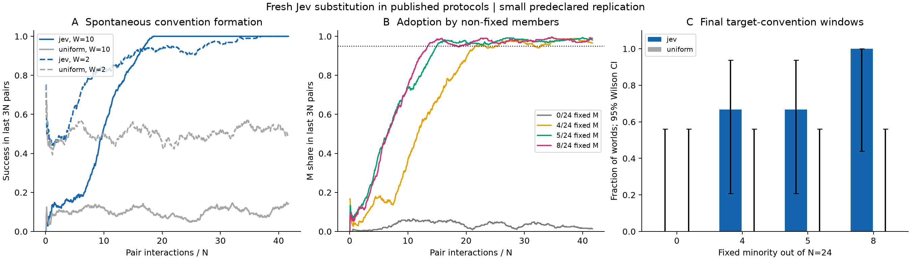
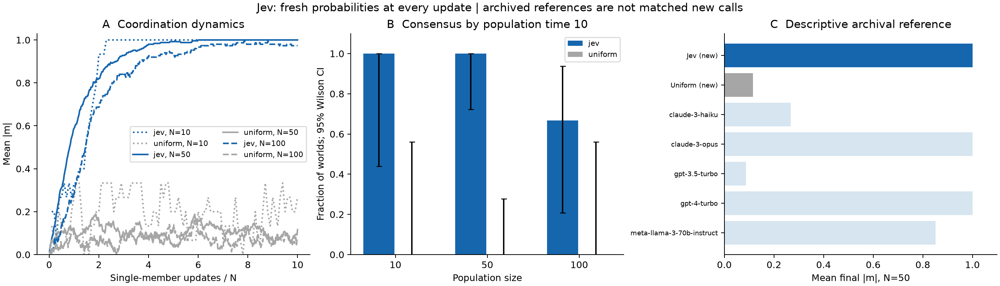

# Convention formation and committed minorities: results

The Ashery et al. naming-game adaptation uses 24 agents, pairwise encounters, local interaction history and source payoffs. Eight spontaneous Jev worlds vary memory windows 10 and 2 over four seeds each. All eight reach the convention criterion; none of eight uniform-choice controls do. A 1,000-pair cap is added, and the terminal window contains 72 pairs.

Twelve minority worlds cross 0, 4, 5 and 8 committed M players with three seeds. Final ordinary-member M shares are 1.4%, 96.6%, 98.2% and 99.0%; terminal criterion counts are 0/3, 2/3, 2/3 and 3/3. The naming arm contains 28,177 fresh Jev choices. Saved records preserve every local input, action, reward and trajectory.

The same infrastructure replays the authors' 39 archived experiments, 12,449 pairs and 22,622 nonfixed-member choices, reproducing interactions, final individual histories and payoffs. Source-record replay and new model-generated trajectories are separate evidence. The organizational extension adds reporting relationships, departments and information permissions.

## Configuration and execution

| Condition | Engine | Worlds | Criterion count | Final-window coordination | Final-window ordinary-member M share |
| --- | --- | ---: | ---: | ---: | ---: |
| spontaneous_W10 | jev | 4 | 4 | 1.000 | — |
| spontaneous_W10 | uniform | 4 | 0 | 0.142 | — |
| spontaneous_W2 | jev | 4 | 4 | 1.000 | — |
| spontaneous_W2 | uniform | 4 | 0 | 0.497 | — |
| Q_to_M_0 | jev | 3 | 0 | 0.972 | 0.014 |
| Q_to_M_0 | uniform | 3 | 0 | 0.495 | 0.512 |
| Q_to_M_4 | jev | 3 | 2 | 0.944 | 0.966 |
| Q_to_M_4 | uniform | 3 | 0 | 0.532 | 0.535 |
| Q_to_M_5 | jev | 3 | 2 | 0.972 | 0.982 |
| Q_to_M_5 | uniform | 3 | 0 | 0.505 | 0.554 |
| Q_to_M_8 | jev | 3 | 3 | 0.986 | 0.990 |
| Q_to_M_8 | uniform | 3 | 0 | 0.509 | 0.476 |

| Population | Engine | Worlds | Consensus by t≤10 | Mean final coordination |
| ---: | --- | ---: | ---: | ---: |
| 10 | jev | 3 | 3 | 1.000 |
| 10 | uniform | 3 | 0 | 0.267 |
| 50 | jev | 10 | 10 | 1.000 |
| 50 | uniform | 10 | 0 | 0.116 |
| 100 | jev | 3 | 2 | 0.973 |
| 100 | uniform | 3 | 0 | 0.053 |

## Sources and records

- [Convention and coordination results (JSON)](behavior_results.json)
- [Simulation trajectories (CSV)](trajectories.csv)

## Figures

