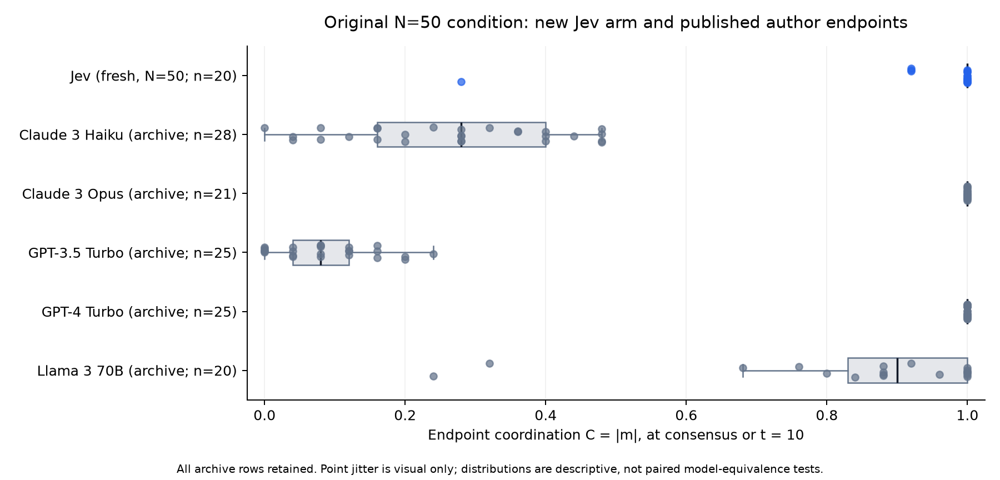

# Majority coordination: complete twenty-world N=50 condition

The new Jev arm executes the source Fig. 2 condition: twenty independent populations of 50, balanced initial opinions, no memory or reward, and up to t=10 (500 asynchronous updates). Sixteen worlds reach consensus, with mean final coordination 0.952. The four remaining endpoints are 0.92, 0.92, 0.28, and 0.92. Consensus worlds stop inference at attainment; plotted tails extend their terminal state. Horizon-censored worlds complete all 500 updates.

## Source comparison

All archived endpoint rows are retained for five source models, including files containing 20-28 rows rather than the figure caption's twenty. Jev's endpoint distribution shows endogenous coordination and differs across engines. The current twenty-world run is separate from the earlier ten-world pilot.

Among consensus worlds, first-consensus time averages t=5.34875 (267.44 updates), with range 2.96-8.74. Fifteen reach the underlying negative label and one the positive label; these are arbitrary analysis codes remapped to k/z at each update. Alias, label-order, and finite-sample effects remain identifiable follow-up questions.

## Timing and accounting

The source records m before each update. This report retains pre- and post-update values and uses the actual final population. At the horizon, a single update can change C by at most 2/N=0.04; all four censored endpoints are unchanged across the final update. Consensus endpoints are one.

The run returns 6,279 judgments across 500 successful responses and 501 attempts, with 2,340,251 input and 293,190 output tokens. Provider-reported successful-response cost is $0.098290542; the execution and verification period is 591.792 seconds. An ambiguous-request reserve of $0.000611184 is recorded separately. All regenerated local inputs and trajectories match saved-probability replay.

Twenty independent worlds share batches only for currently ready updates. Each next observation depends on its own world's preceding choice.

## Configuration and execution

| Metric | Observed result |
| --- | ---: |
| Completed worlds | 20 |
| Consensus by t<=10 | **16/20 (80%)** |
| Censored at t=10 | **4/20** |
| Mean final C | **0.952** |
| Median final C | **1.000** |
| Four non-consensus endpoints | **0.92, 0.92, 0.28, 0.92** |
| Mean first-consensus time among 16 consensus worlds | t=5.34875, about 267.44 updates |
| Consensus-time range | t=2.96–8.74 |
| Fresh individual judgments | **6,279** |

| Model and data source | Worlds / archived rows | Consensus count | Mean C | Median C | Interquartile range |
| --- | ---: | ---: | ---: | ---: | --- |
| **Jev, fresh source-condition run** | **20** | **16** | **0.9520** | **1.00** | **1.00–1.00** |
| Claude 3 Haiku, author archive | 28 | 0 | 0.2671 | 0.28 | 0.16–0.40 |
| Claude 3 Opus, author archive | 21 | 21 | 1.0000 | 1.00 | 1.00–1.00 |
| GPT-3.5 Turbo, author archive | 25 | 0 | 0.0864 | 0.08 | 0.04–0.12 |
| GPT-4 Turbo, author archive | 25 | 25 | 1.0000 | 1.00 | 1.00–1.00 |
| Llama 3 70B, author archive | 20 | 8 | 0.8520 | 0.90 | 0.83–1.00 |

| Recorded item | Verified receipt / manifest value |
| --- | ---: |
| Returned model | `typesafe/jev-1.14-20261014` |
| Attempted requests | **501** |
| Successful responses | **500** |
| Judgments in successful responses | **6,279** |
| Input / output tokens | 2,340,251 / 293,190 |
| Reported successful-response cost | **$0.098290542** |
| Execution and verification time | **591.792 seconds, about 9 min 52 sec** |
| Retry record | One RemoteDisconnected, followed by a successful bounded retry |

## Sources and records

- [AI agents can coordinate via majority-following beyond human scale — full text](https://pmc.ncbi.nlm.nih.gov/articles/PMC13475478/)
- [Science Advances source-protocol audit](sa_original.md)
- [Convention formation and committed minorities: results](../llm_abm_cookbook/behavior_results/README.md)
- [Majority-coordination author endpoint data (JSON)](demarzo_author_endpoints.json)
- [Majority-coordination results (JSON)](demarzo_results.json)
- [Majority-coordination results by world (CSV)](demarzo_worlds.csv)
- [Majority-coordination model comparison (CSV)](demarzo_comparison.csv)
- [Verification report (JSON)](../appendix_ordo_v2_evidence/majority/verification.json)
- case manifests: `../../runs/llm-original-sa-demarzo-20261030/case_results.json` (local run artifact)
- [Recorded experiment configuration (JSON)](../appendix_ordo_v2_evidence/majority/plan-before-calls.json)

## Figures

