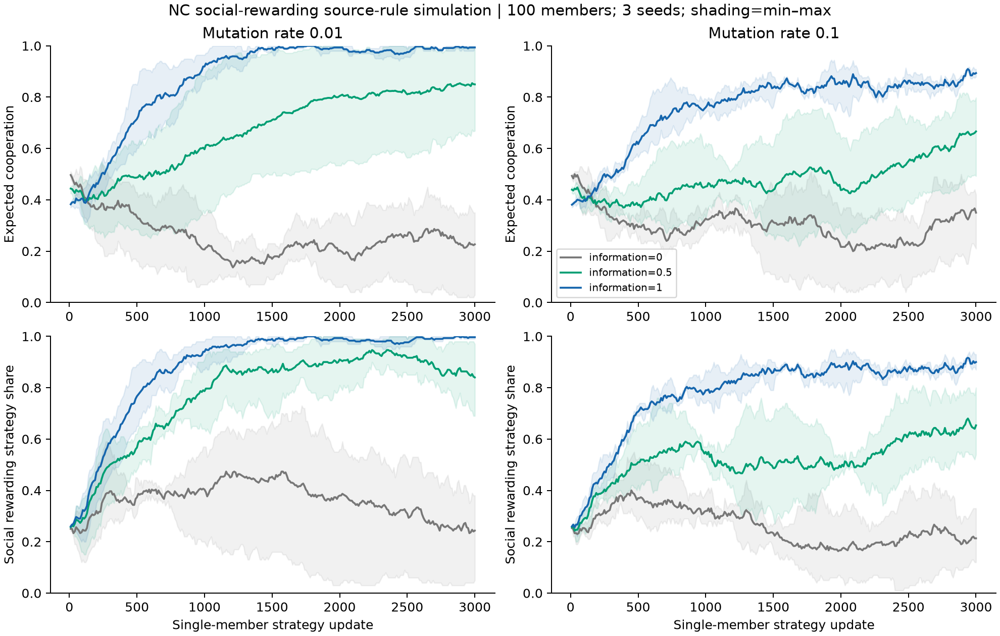

# Additional-game verification results

The archived verification checks compare ORDO's adapted state updates and metrics against the declared source reference. Per-condition tables below retain seeds, decisions and discrepancies. These are free native-policy checks; fresh model-policy outcomes have a separate analysis record.

## Configuration and execution

| Information visibility λ | Mutation rate | Cooperation | Social-reward strategy share |
| ---: | ---: | ---: | ---: |
| 0 | 0.01 | 23.7% | 30.8% |
| 0 | 0.1 | 26.3% | 20.9% |
| 0.5 | 0.01 | 82.3% | 90.2% |
| 0.5 | 0.1 | 54.7% | 58.7% |
| 1 | 0.01 | 98.5% | 98.7% |
| 1 | 0.1 | 85.2% | 87.5% |

## Sources and records

- [Pal & Hilbe (2022), Nature Communications 13:5928](https://doi.org/10.1038/s41467-022-33551-y)
- [Additional Nature Communications game adapters](../README.md)
- [Verification report (JSON)](verification.json)
- [Source manifest (JSON)](sources.json)
- [Results by experimental world (CSV)](world_summary.csv)
- [Simulation trajectories (CSV)](trajectories.csv)

## Figures

