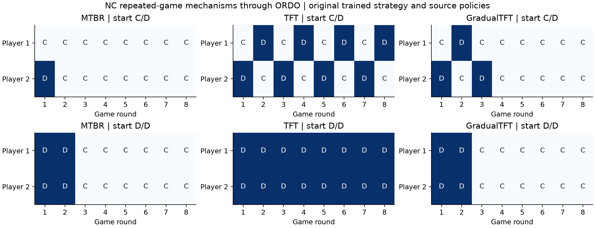
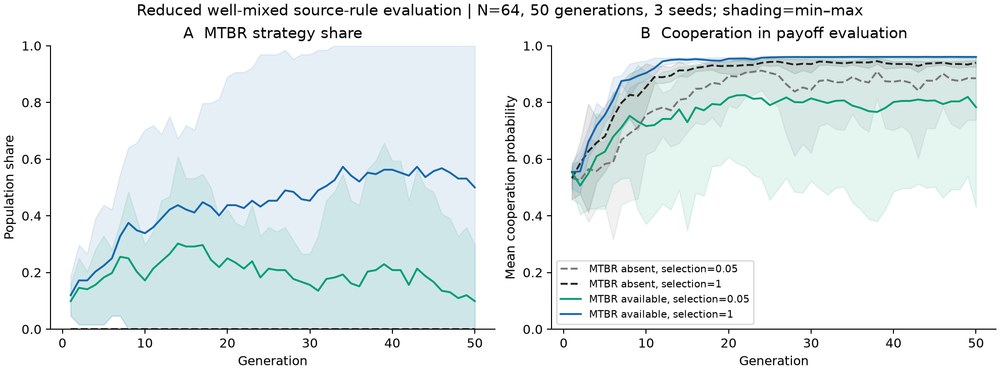

# Evolutionary-game verification results

The recorded source-policy checks cover 972 strategy-pair worlds and 12 evolutionary population worlds. Population runs use 64 members and 50 generations. The adapter compares native payoffs, strategies, population changes and metrics under matched randomness. Tables and machine-readable verification retain each condition and exact checks. Archived MTBRQ data are used directly; the source reinforcement-learning training is not repeated.

## Configuration and execution

| Self-play strategy | C/D initialization | D/D initialization |
| --- | --- | --- |
| Archived trained MTBR | C/C from round 2 | C/C from round 3 |
| TFT | Alternating C/D and D/C | Persistent D/D |
| GradualTFT | C/C from round 4 | C/C from round 3 |

| Initial strategy set | Selection strength | Mean final MTBR share | Mean final evaluated cooperation |
| --- | ---: | ---: | ---: |
| Without MTBR | 0.05 | 0.0% | 88.5% |
| Without MTBR | 1 | 0.0% | 94.0% |
| With MTBR | 0.05 | 9.9% | 78.3% |
| With MTBR | 1 | 50.0% | 96.0% |

## Sources and records

- [Source paper](https://doi.org/10.1038/s41467-025-67178-6)
- [Evolutionary repeated-game source adapter](../README.md)
- [Verification report (JSON)](verification.json)
- [Source manifest (JSON)](sources.json)
- [Results by strategy pair (CSV)](pair_summary.csv)
- [Evolutionary outcomes (CSV)](evolution_summary.csv)

## Figures

