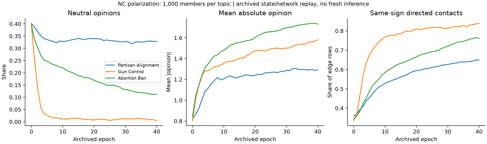

# Polarization archive replay results

Three topics and 41 snapshots per topic yield 123 reconstructed snapshots. The source replay covers 491,474 contact rows and 120,000 state assignments. Opinion vectors, contacts and metrics match the archived data. All judgments here come from source records; the run makes zero API calls. Fresh generated interaction has its own run manifest.

## Configuration and execution

| Topic | Matched condition | Final neutral share | Final mean absolute opinion |
| --- | --- | ---: | ---: |
| Partisan alignment | Correction / self-regulation (Figure 2d) | 32.8% | 1.292 |
| Gun control | Baseline (Figure 1) | 0.4% | 1.582 |
| Abortion ban | Correction / self-regulation (Figure 2d) | 11.3% | 1.732 |

## Sources and records

- [Network-polarization source records](../README.md)
- [Verification report (JSON)](verification.json)
- [Simulation trajectories (CSV)](trajectories.csv)
- [Source manifest (JSON)](source_manifest.json)
- [Source-data license](UPSTREAM_LICENSE.txt)

## Figures

