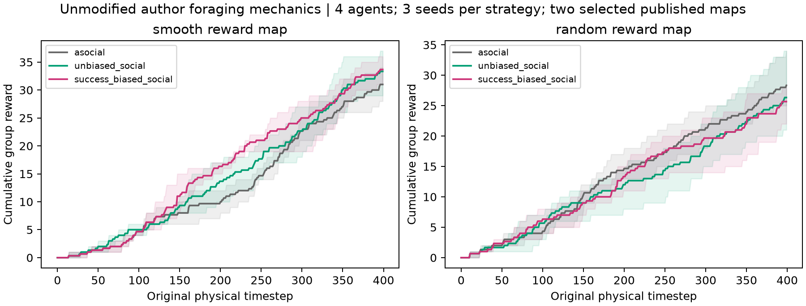

# Native-foraging verification

Eighteen worlds cover clustered and random maps, three source policies and three seeds. Four agents run for 400 physical steps in each world, producing 2,096 policy decisions overall. Native local observations, target selection, movement and reward are checked through the source adapter. Results retain physical-time and decision-stage counts separately.

## Configuration and execution

| Map | Native policy | Mean group reward | Mean revealed resource cells |
| --- | --- | ---: | ---: |
| smooth | asocial | 31.0 | 114.0 |
| smooth | unbiased_social | 33.3 | 107.3 |
| smooth | success_biased_social | 33.7 | 106.7 |
| random | asocial | 28.3 | 113.3 |
| random | unbiased_social | 26.3 | 103.7 |
| random | success_biased_social | 25.7 | 107.7 |

## Sources and records

- [Adaptive mechanisms of social and asocial learning in immersive collective foraging](https://doi.org/10.1038/s41467-025-58365-6)
- [Collective foraging and social learning](../foraging.md)
- [Verification report (JSON)](verification.json)
- [Outcome summary (CSV)](summary.csv)
- [Simulation trajectories (CSV)](trajectories.csv)

## Figures

