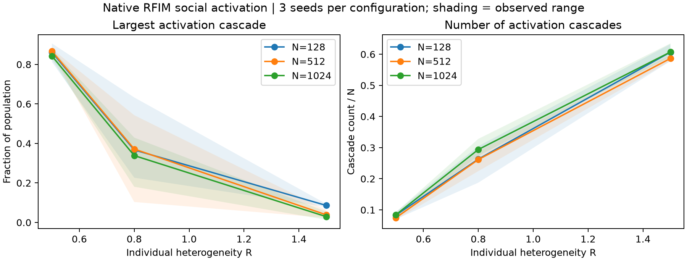

# Social-reward source verification

The suite runs 18 worlds with 100 members and 3,000 source updates each, totaling 54,000 updates. The adapter retains strategy revision, analytical payoffs and source random draws. Saved results compare states and metrics against direct kernel execution. This finite-horizon verification is separate from the source's long-run population analysis and from Jev policy-transfer results.

## Configuration and execution

| Population | R | Mean largest-cascade share across three seeds | Mean cascade count |
| ---: | ---: | ---: | ---: |
| 128 | 0.5 | 86.2% | 10.7 |
| 128 | 0.8 | 36.7% | 33.7 |
| 128 | 1.5 | 8.6% | 77.7 |
| 512 | 0.5 | 86.7% | 38.3 |
| 512 | 0.8 | 37.2% | 134.0 |
| 512 | 1.5 | 3.8% | 300.3 |
| 1024 | 0.5 | 84.3% | 86.7 |
| 1024 | 0.8 | 33.9% | 301.0 |
| 1024 | 1.5 | 2.9% | 621.7 |

## Sources and records

- [Universality, criticality and complexity of information propagation on social media](https://doi.org/10.1038/s41467-022-28964-8)
- [Outcome summary (CSV)](summary.csv)
- [Verification report (JSON)](verification.json)
- [Results by group (JSON)](group_summary.json)
- [Nature Communications interaction adapters](../README.md)

## Figures

