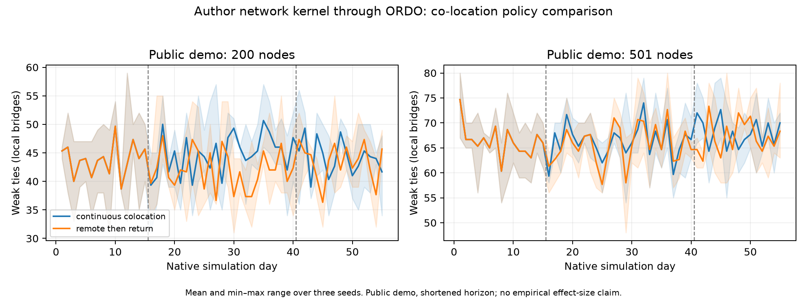

# NCS cookbook: co-location and organizational communication networks

**Published original research:** Carmody et al. (2022), *The effect of co-location on human communication networks*, **Nature Computational Science 2, 494–503**. [Paper](https://www.nature.com/articles/s43588-022-00296-z), [author Code Ocean release](https://doi.org/10.24433/CO.5754680.v1), [public Git source](https://git.codeocean.com/capsule-8904315.git), [additional public representative dataset](https://zenodo.org/records/6809296).

The paper combines analysis of MIT researcher communication with a stochastic network-evolution model. It models communication through past interactions, department membership, proximity, periodicity and triadic closure. Co-location modifies these mechanisms. This cookbook runs the **published simulation kernel**, using the public capsule demo; it does not obtain private MIT data or reproduce the full empirical analysis.

## Run

From the repository root, install the project's cookbook dependencies (`pip install -e ".[cookbooks]"`). The simulation itself uses NumPy and NetworkX; export additionally uses Matplotlib. Git must be on PATH to download the author capsule. No paid service or credential is required.

```powershell
python -m examples.ncs_colocation.run --download --output runs/ncs-colocation-local
python -m examples.ncs_colocation.export --run runs/ncs-colocation-local
python -m unittest discover -s tests -p test_ncs_colocation.py -v
```

For the existing local Windows dependency caches:

```powershell
$env:PYTHONPATH = '.deps;.buildtmp/behavior-plot-deps;.buildtmp/nc-social-deps'
```

Edit [plan.json](../../examples/ncs_colocation/plan.json) or supply `--plan path.json`: public-demo populations, seeds, the two policies, and three phase durations are editable. The checked run uses 200 and all 501 public-demo nodes, seeds 7/11/19, 15 baseline days, 25 intervention days and 15 return days. `continuous_colocation` holds original distances throughout; `remote_then_return` sets all candidate pair distances to 2,000 during the middle phase, as in the author's simulation intervention.

## What is preserved and what changes

The pinned upstream commit is `cbb02661a19d73136dc585645f6f2422054b15a7`, release `v1.0`. The upstream `code/LICENSE` is MIT, copyright Daniel Carmody (2022). Source and demo pickles are downloaded into the ignored `.buildtmp/ncs-colocation-source` cache; the upstream notebook is not redistributed in this cookbook. The loader checks the commit and rejects tracked local modifications. Audit JSON contains SHA256 hashes of each loaded file. Public pickle loading is restricted to the graph/date classes used in the capsule.

The loader extracts only the utility cell and `graph_generator` class from `SimulationsSubmission.ipynb`. Unrelated notebook imports, email analyses, regressions and plots are not executed. Unused sklearn estimator base classes are stubbed; the notebook's progress range is replaced by `range`. Actual graph transition and sampling code is retained.

The author performs two weighted edge samples **without replacement** each day (about 50 then 20 edges), with memory updates and second-stage triadic closure. These coupled native draws remain in the environment. They are not reinterpreted as independent agent probabilities. ORDO's public `Environment.describe`, `prepare`, `advance`, `DecisionBatch`, `FunctionEngine` and `run_simulation` interfaces advance and record one complete native day. The decision batches are empty: **this is native ABM environment integration, with zero external decision-model calls**, not evidence for Jev or an LLM's behavioral accuracy.

One AST `yield` is inserted after the original complete-day loop body to expose a daily transition. A separate reference calls the **unmodified** `transform` method over each entire phase. With identical inputs and NumPy RNG streams, all daily graph nodes/edges, weak-tie counts, component counts, phase-boundary memories and final full edge histories must agree. A second SDK run reconstructs recorded inputs and native trajectories from seed; it is deterministic native re-execution, not an action-only replay independent of the source kernel.

The original notebook's `0 < date.weekday() < 6` convention (Tuesday–Saturday) and its initial ten graphs `[26:36]` are retained and documented. Available candidate edges come from the author's public graph pool. Only the initial memory dictionary is sorted for process-independent iteration. NetworkX 3.7, NumPy 2.5.4 and Python 3.12.14 were used locally; exact verification is within this environment, not an assertion of bitwise equality to the author's Python 3.8/NetworkX 2.7.1 installation. Reduced population and duration are declared in the plan.

## Evidence and organizational use

See [compact verification](results/verification.json), [world summary](results/summary.csv), [daily trajectories](results/trajectories.csv), [group summary](results/group_summary.json) and [figure](results/colocation_policy.png). Full author references, final individual edge memory, SDK manifests and daily logs are retained in `runs/ncs-colocation-20261030/`.

This provides a directly organizational cookbook: **how a change in physical work arrangements changes a network connecting departments**. It supports the claim that ORDO can host a published organizational social-network simulation and schedule an external workplace policy. The checked run establishes native-kernel equivalence on these public inputs. Short demo-policy contrasts are illustrative; they do not reproduce the paper's MIT estimates, establish a general policy effect, validate human fidelity or demonstrate large-scale decision-model speed/cost gains.


