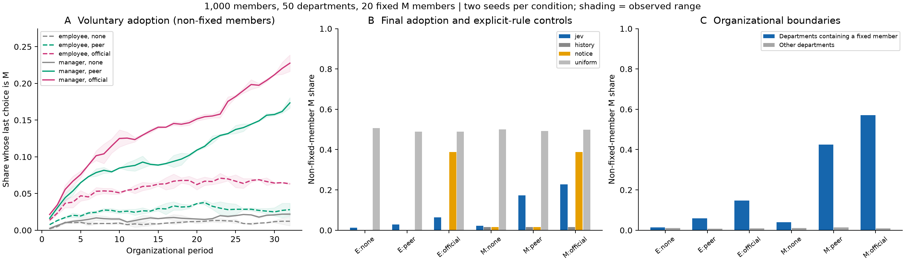

# Organizational conventions: recorded results

The convention-formation experiment uses organizations of 1,000 and 10,000 members, with executive, manager, and employee reporting levels, twenty members per department, and 2% committed members. The 1,000-member factorial design crosses placement and guidance over six conditions and two seeds; the 10,000-member run uses manager placement with formal guidance and one seed. Records cover the model decisions and accompanying rule-based runs.

## Findings

Under formal guidance, ordinary members' latest M share averages 6.3% for committed employees and 22.8% for committed managers. For manager placement, peer guidance yields 17.3% and formal guidance 22.8%. In the manager/formal condition, seeded departments reach 57.1% and other departments 1.0%; at 10,000 members these rates are 59.89% and 1.28%, with 24.01% adoption overall.

Shares exclude committed members. Placement changes both contact opportunities and role context. Peer and formal guidance match content, readers, and exposure; formal guidance adds validated publishing rights. Members choose voluntarily.

## Execution and verification

Both populations run for thirty-two periods with synchronous settlement: 125 disjoint pairs per period at 1,000 members and 1,250 at 10,000. Members retain five interactions and read notices under departmental permissions. Reported coordination covers the final period; trajectories preserve every period.

All four engines reproduce regenerated local inputs, period metrics, and complete final individual states through saved-probability replay. The checks also match populations, reporting, contacts, and peer/formal exposure. The factorial runs contain 92,058 model decisions, and the larger run contains 74,693.

Recorded probabilities and replay manifests reconstruct inputs, metrics, and final states at both population sizes.

## Configuration and execution

| Members | Committed-member placement | Information condition | Ordinary-member M share | Seeded-department M share | Other-department M share | Final-period coordination |
| ---: | --- | --- | ---: | ---: | ---: | ---: |
| 1,000 | employee | none | 1.2% | 1.4% | 1.1% | 96.4% |
| 1,000 | employee | peer | 2.8% | 5.9% | 0.8% | 94.0% |
| 1,000 | employee | official | 6.3% | 14.7% | 1.0% | 86.4% |
| 1,000 | manager | none | 2.2% | 3.9% | 1.1% | 82.0% |
| 1,000 | manager | peer | 17.3% | 42.5% | 1.4% | 80.8% |
| 1,000 | manager | official | 22.8% | 57.1% | 1.0% | 82.0% |
| 10,000 | manager | official | 24.01% | 59.89% | 1.28% | 82.0% |

```bash
python tools/replay_organizational_conventions.py --evidence docs/organizational_conventions/results
python tools/replay_organizational_conventions.py --evidence docs/organizational_conventions/scale_10000/evidence
```

## Sources and records

- [Detailed results (JSON)](results.json)
- World summaries: [1,000 members](world_summary.csv), [10,000 members](../scale_10000/summary.csv)
- Trajectories: [1,000 members](trajectories.csv), [10,000 members](../scale_10000/trajectory.csv)
- [Conventions, positions, and publishing permissions in a large organization](../README.md)

## Figures


